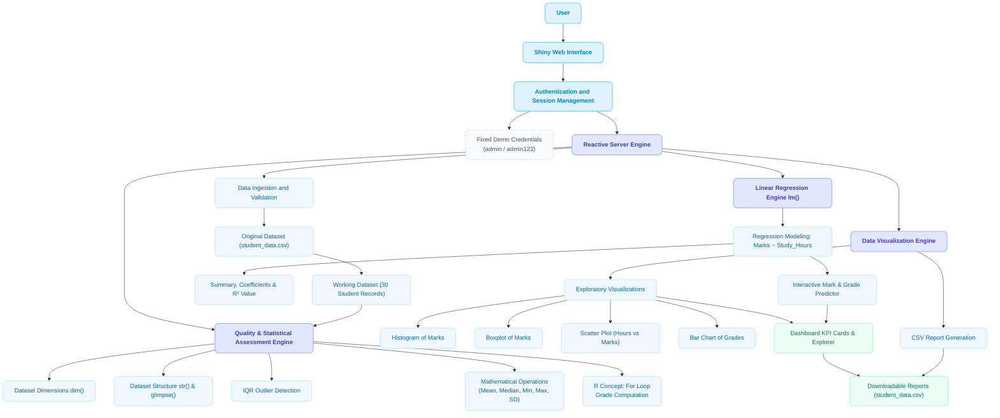

# 📊 System Flow & Architecture Diagram

This flowchart outlines the end-to-end data pipeline and reactive architecture of the **Student Performance Analysis System**, modeled after your reference structure:

---

## 📌 Flowchart Components Breakdown

| Layer / Stage | Function in Project | File / Implementation |
| :--- | :--- | :--- |
| **User & Interface** | User interacts with login and analytical dashboard | `app.R` (UI Definition) |
| **Authentication** | Demo credentials verification (`admin` / `admin123`) & session logout | `app.R` (Server Auth logic) |
| **Reactive Server Engine** | Central controller handling reactivity, inputs, and triggers | `app.R` (Shiny Server function) |
| **Data Ingestion & Dataset** | Generates or loads 30 fictional student records | `generate_data.R`, `student_data.csv` |
| **Quality & Statistical Engine**| Computes `dim()`, `str()`, `glimpse()`, descriptive stats & IQR outliers | `analysis.R` & Analysis Tab |
| **R Loop Grade Engine** | Executes `for` loop to categorize students into grades (A–F) and attendance tiers | `generate_data.R`, `analysis.R` |
| **Linear Regression Engine** | Fits `lm(Marks ~ Study_Hours)`, derives $R^2 = 96.1\%$, and powers interactive slider prediction | `app.R` (Regression Tab) & `analysis.R` |
| **Visualization Engine** | Renders Histogram, Boxplot, Scatter Plot, and Bar Chart | `app.R` (Visualizations Tab) |
| **Dashboard Results & Reports** | Executive summary KPI cards, letter grade filter, and CSV download | `app.R` (Dashboard & Explorer Tabs) |

---

## 🌐 Opening the Interactive HTML Flowchart
You can also open the beautifully rendered visual version directly in your browser:
* Open file: [`docs/flowchart.html`](file:///Users/parassehgal/.gemini/antigravity/scratch/student_performance_analysis/docs/flowchart.html)
